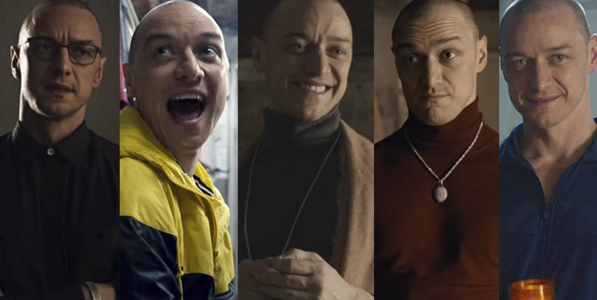
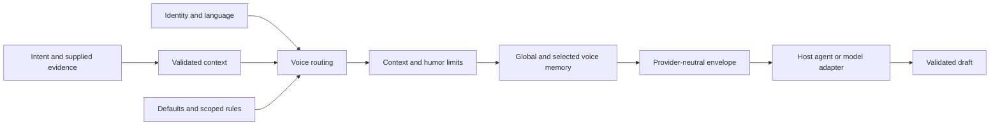

<p align="center">
  
</p>

# Kevin

**One mind. Many voices. Always you.**

Open source under the [MIT License](LICENSE). [Contributions are welcome](CONTRIBUTING.md).

Kevin helps AI assistants communicate in your voice, adapted to the task, audience and stakes. It combines a portable agent skill with a native Rust CLI for voice selection, local memory and provider-independent composition.

Twelve developer voices are included. **`tony-stark` is the starting default**: confident, concise and quick-witted, with optional dry humor. You can use it immediately, create your own personality, or assign different voices to reviews, Slack channels and specific people.

No mandatory cloud account, Node/npm runtime, telemetry, database or model vendor. Generating new text still requires your host agent or an explicitly selected model adapter.

## Contents

- [Install](#install)
- [Quick start](#quick-start)
- [Included voices and defaults](#included-voices-and-defaults)
- [Create a personality](#create-a-personality)
- [Choose voices by context](#choose-voices-by-context)
- [Global and per-voice memory](#global-and-per-voice-memory)
- [Use the agent skill](#use-the-agent-skill)
- [Generation and model adapters](#generation-and-model-adapters)
- [Use Kevin in a review project or CI](#use-kevin-in-a-review-project-or-ci)
- [Configuration and architecture](#configuration-and-architecture)
- [Verification and limits](#verification-and-limits)
- [Contribute](#contribute)
- [License](#license)

## Install

Prebuilt binaries and a portable skill ZIP are available from [GitHub Releases](https://github.com/ruverd/kevin/releases/latest). Choose macOS ARM64 (Apple Silicon), Linux x86-64 or Windows x86-64, extract the archive, and put the executable on your PATH. Check the archive against the release's `SHA256SUMS`. Prebuilt binaries require no Rust, Node or npm installation.

For direct agent use, extract the skill ZIP and copy the complete `kevin` folder, including `references`, into your [host's skill home](#use-the-agent-skill). No CLI is required.

From source, with Rust 1.89 or newer:

```bash
git clone https://github.com/ruverd/kevin.git
cd kevin
cargo install --path crates/kevin-cli --locked
kevin --version
```

If a newly installed Rust toolchain is not on your shell's PATH, load its environment with `source "$HOME/.cargo/env"` first. During development, use `cargo run -p kevin -- <arguments>` from the checkout.

The executable embeds the skill and all references. It runs without Node, npm or a source checkout. CI also builds development binaries as [workflow artifacts](https://github.com/ruverd/kevin/actions): choose your OS/architecture, extract the artifact, then run `chmod +x kevin` on Unix. Binary compatibility still depends on the target's system libraries.

## Quick start

Voices work immediately; no onboarding or profile file is required:

```bash
kevin voices
kevin voice default
# tony-stark

kevin reply --intent "Say I'll take a look after lunch, without promising a fix." \
  --platform slack --audience teammate --seriousness ordinary --prompt
```

`--prompt` exports instructions for a model. It is not a generated reply. Without `--model-command`, Kevin reports that distinction on stderr. To inspect deterministic selection, use `--json`:

```bash
kevin reply --request examples/slack.json --json
kevin review --request examples/review.json --prompt
kevin draft --request examples/pr.json --prompt
```

The example files are included in the checkout. Requests can describe a task, audience, language, conversation, supported facts and strings that must be preserved.

To generate through an already running local Ollama server with an installed model:

```bash
export KEVIN_MODEL=your-installed-model
kevin reply --request examples/slack.json \
  --model-command kevin --model-arg ollama
```

This returns one draft. Kevin does not post it anywhere. For agent-native generation without a CLI model adapter, use the [skill](#use-the-agent-skill).

## Included voices and defaults

| Voice ID | Best fit | Expression |
| --- | --- | --- |
| **`tony-stark`** | Everyday developer communication; starter default | Confident technical delivery, concise phrasing, optional dry wit |
| `chandler` | Casual Slack exchanges and existing banter | Short spontaneous remarks, light occasional self-deprecation, responsive humor |
| `professional-reviewer` | Code review and PR descriptions | Precise trigger, consequence and concrete next step |
| `rubber-duck` | Debugging and explaining code | Patient questions, assumptions and small concrete examples |
| `pragmatic-architect` | Design discussions | Constraints, meaningful tradeoffs and a concrete recommendation |
| `incident-commander` | Operational updates | Confirmed impact, uncertainty and supported next steps; no humor |
| `friendly-teammate` | Collaboration and ordinary Slack | Warm, helpful and conversational |
| `diplomat` | Sensitive disagreement and external communication | Tactful, careful attribution and clear wording |
| `minimalist` | Short status or direct answers | Essential facts and next action |
| `witty-engineer` | Invited technical banter | Concise situational observations |
| `dry-comedian` | Ordinary exchanges that already invite humor | Understatement and restrained irony |
| `neutral` | An explicit base-identity voice | No added personality overlay |

The Stark-inspired and Chandler-inspired voices use reusable traits, not copied dialogue, catchphrases or claims to be the characters. Chandler follows an existing joke without escalating it, keeps self-deprecation light and occasional, and avoids implying incompetence or inventing personal mishaps. Humor is optional. Reviews, incidents, blocked work, tense exchanges and uncertain stakes keep humor off, even when a humorous voice is forced.

```bash
kevin voices                         # Names and descriptions; default is marked
kevin voices --json                  # Complete configured definitions
kevin voice default                  # Current default
kevin voice default minimalist       # Persist a new default
kevin voice default tony-stark        # Restore the Stark-inspired default
kevin reply --voice chandler --platform slack --audience teammate \
  --seriousness ordinary --energy playful --intent "Reply to the supplied joke." --prompt
kevin reply --voice rubber-duck --intent "Explain the supplied behavior." --prompt
```

An explicit default change persists a local profile. A one-request `--voice` does not. Specific context rules can select another voice, such as the reviewer for a code review. Existing saved profiles retain their own defaults and definitions; upgrades do not silently replace them.

## Create a personality

Describe the personality and let Kevin fill the gaps:

```bash
kevin voice create field-engineer \
  --description "Direct, friendly, technically confident, dry humor without arrogance"
```

In a terminal, Kevin asks one question at a time, recommends an answer, offers example replies for comparison, and shows the proposed voice plus a serious-context preview. It saves only after confirmation. The local questionnaire is deterministic; its previews are labeled fictional fixtures.

In an agent, use Kevin's [voice interview](skills/kevin/references/voice-interview.md) for deeper model-driven gap analysis:

```text
Use Kevin to create a personality: confident engineer, concise,
with dry humor and no arrogance. Ask one question at a time,
show example replies, and let me refine the voice before saving it.
```

For noninteractive use, complete [example answers](examples/voice-answers.json) and review the proposal:

```bash
kevin voice create field-engineer --description "Direct, friendly, dry humor" \
  --answers examples/voice-answers.json

# Persist only after reviewing the proposal:
kevin voice create field-engineer --description "Direct, friendly, dry humor" \
  --answers examples/voice-answers.json --save
```

Without complete answers, noninteractive mode returns the next question as JSON. You can also create or replace definitions directly:

```bash
kevin voice create concise-colleague < examples/custom-voice.json
kevin voice edit concise-colleague < examples/custom-voice.json
```

Creating a voice does not change identity, routing or default. Select it with `--voice`, set it as default, or add a routing rule.

## Choose voices by context

Assign voices to an action, channel or recipient:

```bash
kevin rule set review-comments --task review --voice professional-reviewer
kevin rule set team-channel --platform slack --workspace T_EXAMPLE \
  --channel C_EXAMPLE --voice tony-stark --priority 80
kevin rule set specific-person --platform slack --workspace T_EXAMPLE \
  --recipient U_EXAMPLE --voice minimalist --priority 85
kevin rules
kevin rule remove team-channel
```

Supply the same metadata when composing:

```bash
kevin reply --intent "Say I'll take a look after lunch." \
  --platform slack --workspace T_EXAMPLE --channel C_EXAMPLE \
  --recipient U_EXAMPLE --audience teammate --seriousness ordinary --json
```

Selection order is **manual voice → highest-priority matching rule → default**. Conditions use exact equality and AND; declaration order breaks priority ties. There is no hidden specificity score. `rule set` creates or replaces a named rule, defaulting to priority 80. Starter critical/sensitive rules use 100/90. Humor constraints always run after selection.

Metadata must come from the user or an authorized adapter. Kevin does not discover a Slack channel, infer a relationship or treat a quoted name as a verified recipient. Prefer stable IDs with workspace disambiguation. See [routing details](skills/kevin/references/routing.md).

## Global and per-voice memory

Store approved preferences or notes locally:

```bash
kevin memory add --kind preference --text "Avoid corporate filler."
kevin memory add --voice professional-reviewer --kind preference \
  --text "Explain the consequence before suggesting a change."
kevin memory list
kevin memory list --voice professional-reviewer
kevin memory list --all
kevin memory remove ENTRY_ID --voice professional-reviewer
```

Without `--voice`, commands target global memory. Composition receives global entries plus only the selected voices' entries. A voice reused across channels carries the same memory in each. Style inheritance does not inherit a parent's memory; explicit blends include their selected scopes.

Default storage is `.kevin/memory.json`, or `memory.json` beside a selected config. `--memory <file>` overrides it. Reads do not create or update files. There is no automatic conversation harvesting or background learning. Memory is user-saved context, not proof of current tests, approvals or commitments. Deletion removes active storage, not past chats, exports or provider logs. See the [memory contract](skills/kevin/references/memory.md).

## Use the agent skill

Install into a consuming project:

```bash
kevin skill install codex
# Or: claude, cursor, generic
```

The installer copies the complete embedded skill and refuses existing destinations. It does not edit global agent settings. You can also copy [skills/kevin](skills/kevin) manually, including its references.

| Host | Project-local location | Typical invocation |
| --- | --- | --- |
| Codex | `.agents/skills/kevin/` | `$kevin` or automatic skill selection |
| Claude Code | `.claude/skills/kevin/` | `/kevin` |
| Cursor | `.cursor/skills/kevin/` | Select Kevin through the host's supported skill UI |
| Generic agent | Load `SKILL.md` and relevant references | Ask the agent to use Kevin |

No runtime is required for direct skill use. Hosts differ in history, tool access and command discovery; there is no universal slash-command protocol. See [adapter details](docs/adapters.md).

## Generation and model adapters

| Option | Result |
| --- | --- |
| `--json` | Validated context, selected voices, filtered memory and constraints |
| `--prompt` | Portable composition instructions and input data |
| `--model-command <executable>` | Actual generation through your chosen adapter |

A model adapter reads one envelope JSON from stdin and writes one result JSON to stdout. Repeat `--model-arg` for arguments; Kevin invokes them without a shell. The native `kevin ollama` adapter uses loopback port 11434, temperature 0 and seed 42; `KEVIN_OLLAMA_PORT` can select another loopback port. It starts no server and downloads no models.

The selected adapter receives the profile, supplied evidence and filtered memory. It controls whether data leaves the device. Choose an actual local model for offline inference; a local server can still delegate to a cloud model. See the [provider protocol](docs/providers.md).

Model-agnostic means the skill and core do not require one provider. It does not promise identical quality or instruction compliance across models. Facts, uncertainty and commitments must survive generation; structural validation alone cannot prove that they did.

## Use Kevin in a review project or CI

A review project can version `ci/kevin.json` and make every final comment go through Kevin:

```bash
kevin review --config ci/kevin.json --memory .kevin/memory.json \
  --request review-input.json --model-command ./ci/model-adapter \
  > review-comment.md
```

The flow is **analyzer findings → Kevin composition → existing publisher**. Installing a skill alone does not enforce that path. Require successful generation before publishing the resulting file.

Create the personality outside CI. The job consumes a complete configuration and explicit evidence without interviews or memory writes. Private memory can come from controlled storage; ephemeral runners do not make local files durable.

The [consumer project example](examples/code-review-project/README.md) includes a shared reviewer profile, synthetic request and [GitHub Actions template](examples/code-review-project/workflow.yml). Its priority-200 review rule keeps the project's reviewer voice even for security reviews, with humor still off. The workflow exports prompts without calling a model; the guide shows where a provisioned model adapter fits.

## Configuration and architecture

No profile is necessary for first use. To create an editable private profile before making changes:

```bash
kevin init --language pt-BR
kevin doctor
kevin identity export > identity.json
kevin identity import identity.json
```

`init` refuses existing files. Explicit configuration edits also create a profile when none exists. The implicit location is `.kevin/config.json` in the current directory; Kevin does not scan parents. An explicitly selected missing `--config` is an error. Keep `.kevin/` ignored in consuming repositories, and keep exported identities private.

Use `--config ci/kevin.json` for a deliberately shared configuration. Keep memory separate with `--memory .kevin/memory.json`. JSON v1 profiles and memory from the original implementation remain supported.



`kevin-core` owns schemas, context, routing, constraints, memory filtering and composition. The `kevin` CLI owns files, subprocesses and the optional loopback HTTP adapter. The skill stays Markdown. See [architecture and API](docs/architecture.md), [Rust migration](docs/migration-rust.md) and [privacy limits](docs/privacy.md).

## Verification and limits

```bash
cargo fmt --all -- --check
cargo clippy --workspace --all-targets --locked -- -D warnings
cargo test --workspace --locked
cargo run -p kevin --locked -- eval
```

All 36 original cases were ported. Frozen fixtures compare 34 original composition envelopes and five interview states; the original 30 routing cases still run with their original profile. Additional tests cover new defaults, first use, native distribution, subprocess bounds, scope isolation and the consumer review example. The current starter pack also has 30 automatic/forced routing evaluation cases.

Tests establish deterministic program behavior, not model naturalness or semantic fidelity. Ollama transport tests use a real loopback protocol fixture; live model quality and cross-model certification remain pending. [Evaluation guide](docs/evaluation.md) defines optional recorded model runs and a human review rubric. [Manual skill exercise](evals/skill-exercise.md) is an author-run sample, not an independent benchmark.

Identity sample analysis, automated calibration history/rollback and durable CI memory storage remain future work. Kevin does not send messages, approve reviews, merge code or train models. Quoted messages and memory text are untrusted data; prompt guidance is not an enforceable isolation boundary inside every LLM.

The [reference study](docs/references.md) records the nine projects that informed the design.

## Contribute

Report bugs or propose improvements through [GitHub issues](https://github.com/ruverd/kevin/issues). To contribute code, documentation or public synthetic examples, fork the repository and open a pull request against `main`. See [CONTRIBUTING.md](CONTRIBUTING.md) for development checks and contribution guidelines.

## License

Kevin's original code, agent skill and documentation are open source under the [MIT License](LICENSE). Third-party material retains its own license and notices.

The supplied README banner is excluded from the software license. See the [media notice](docs/assets/README.md).
