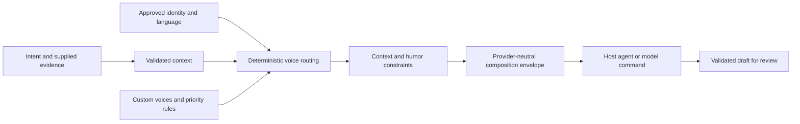

<p align="center">
  
</p>

# Kevin

**One mind. Many voices. Always you.**

Kevin helps an AI assistant write like you, adapted to the conversation. Your identity stays consistent; tone, detail and optional humor change with the audience, language and stakes.

A coffee joke in Slack, a serious review finding and a production incident need different responses. Kevin separates those decisions from text generation. It ships as a portable agent skill and a small TypeScript engine with a CLI. No mandatory cloud account, telemetry, database or model vendor.

## Start with the skill

Copy [skills/kevin](skills/kevin) with its `references` directory into your agent's skill location:

| Host | Project-local destination | Invocation |
| --- | --- | --- |
| Codex | `.agents/skills/kevin/` | `$kevin` or automatic skill selection |
| Claude Code | `.claude/skills/kevin/` | `/kevin` |
| Cursor | `.cursor/skills/kevin/` | Select Kevin through the host's skill UI; syntax varies |
| Generic agent | Load `SKILL.md` and referenced files | Ask it to use Kevin |

No runtime is needed for direct skill use. Hosts must support loading instructions or let you paste them. There is no universal slash-command protocol. Older host versions may need different installation locations; see [adapters](docs/adapters.md).

Example requests:

```text
Use Kevin. Reply to this Slack message in English, in my voice.
Context: teammate, ordinary conversation, already joking.
Message: "Next you will automate my coffee too."
Intent: acknowledge the joke without promising any work.
```

```text
Use Kevin with the professional-reviewer voice.
Finding: items[0].id throws when items is empty.
Write one constructive GitHub comment. Do not invent a test result.
```

```text
Use Kevin. Diz em inglês que vou olhar depois do almoço,
sem prometer corrigir.
```

No profile yet? Kevin uses neutral defaults. It does not pretend those defaults are your learned personality.

## CLI setup

Node.js 22+ and npm:

```bash
git clone https://github.com/ruverd/kevin.git
cd kevin
npm ci
npm run build
npm link
kevin init --language pt-BR
kevin doctor
```

`npm link` is optional. Use `npm run kevin -- <arguments>` from the checkout instead. This release is source-installable; it has not been published to npm. Bun can install dependencies and run the built CLI, but Node remains the supported baseline.

`init` creates a private project-local `.kevin/config.json`, refuses to overwrite an existing profile, and needs no interview. Choose an optional starting style with `--style minimalist`. Edit the generated JSON to set preferences or custom rules. Keep `.kevin/` ignored in consuming repositories too.

```bash
kevin voices
kevin voice default
kevin voice default minimalist
kevin rules
kevin reply --request examples/slack.json --json
kevin reply --request examples/slack.json --prompt
kevin review --request examples/review.json --prompt
kevin draft --request examples/pr.json --prompt
kevin reply --request examples/slack.json --voice minimalist --no-humor --prompt
kevin voice create concise-colleague < examples/custom-voice.json
kevin voice create field-engineer --description "Confident, concise, dry humor, no arrogance"
kevin identity export > identity.json
kevin identity import identity.json
kevin skill install codex
```

The installer copies the complete skill into the current project and refuses existing files. It does not edit global agent settings. Run it in a consuming project using the linked CLI, or pass `--destination /path/to/project/.agents/skills`.

`kevin voices` lists all names and descriptions, marking the default. Use `kevin voices --json` for complete definitions. `kevin voice default <name>` persists the default in the selected profile; `kevin voice default` prints it. Specific routing rules take precedence over the default, and `--voice` overrides selection for one request. Context and humor constraints always apply.

## Assign voices to channels, people and actions

Use rules to bind voices to supplied context, rather than changing the default for every conversation:

```bash
kevin rule set review-comments --task review --voice professional-reviewer
kevin rule set team-channel --platform slack --workspace T_EXAMPLE \
  --channel C_EXAMPLE --voice witty-engineer --priority 80
kevin rule set specific-person --platform slack --workspace T_EXAMPLE \
  --recipient U_EXAMPLE --voice minimalist --priority 85
kevin rules
kevin rule remove team-channel
```

The same context fields can be supplied on requests:

```bash
kevin reply --intent "Say I'll take a look after lunch." \
  --platform slack --workspace T_EXAMPLE --channel C_EXAMPLE \
  --recipient U_EXAMPLE --audience teammate --seriousness ordinary --json
```

Conditions match exactly and combine with AND. Higher priority wins; declaration order breaks ties. `rule set` creates or replaces a named rule, with default priority `80`. Starter critical/sensitive rules use `100`/`90`. A manual `--voice` overrides routing; humor limits still run last. Matching rules use supplied fields even when other metadata is missing, but unknown stakes keep humor off. No channel, person or relationship is inferred from quoted text. Prefer stable IDs and include workspace when necessary. See [routing](skills/kevin/references/routing.md).

## Global and per-voice memory

Keep approved notes or preferences locally, separate from the base identity:

```bash
kevin memory add --kind preference --text "Avoid corporate filler."
kevin memory add --voice professional-reviewer --kind preference \
  --text "Explain the consequence before suggesting a change."
kevin memory list
kevin memory list --voice professional-reviewer
kevin memory list --all
kevin memory remove ENTRY_ID --voice professional-reviewer
```

Without `--voice`, add/list/remove target global memory. Composition receives global entries plus only the selected voices' entries. A voice reused in several channels carries the same memory in each; this is not per-recipient storage. Inheritance does not inherit a parent voice's memory; explicit blends include their named scopes.

Memory lives in `memory.json` beside the selected config, normally `.kevin/memory.json`. Override with `--memory <file>`. Reads do not create or change it. Entries are saved only by an explicit command or an approved agent action, and removal deletes the active entry. No conversation harvesting or implicit learning. Notes are user-saved context, not proof of current test results, approvals or promises. See [memory contract](skills/kevin/references/memory.md).

## Create a personality by describing it

In an agent, ask Kevin to create a voice from a description. It interviews you one question at a time, recommends an answer, resolves gaps and conflicting traits, then offers response examples for comparison. It presents the voice and previews before saving. The [interview guide](skills/kevin/references/voice-interview.md) keeps changes scoped to a new voice rather than replacing your identity.

```text
Use Kevin to create a personality: confident engineer, concise,
dry humor, friendly without forced enthusiasm. Ask me about gaps,
and let me choose between example replies before saving it.
```

The CLI also has a local guided questionnaire. In a terminal, `voice create --description` asks one question at a time, offers example replies, prints the proposed voice plus a serious-context preview, and asks whether to save. No model call is required. Its questions are deterministic; semantic analysis of a nuanced description comes from the agent workflow. Previews are labeled fictional fixtures, not claimed model generations.

For scripts, use [example answers](examples/voice-answers.json):

```bash
# Return the next unanswered question; no profile changes.
kevin voice create field-engineer --description "Confident, concise, dry humor"

# Review a complete proposal. Add --save only when ready to persist it.
kevin voice create field-engineer --description "Confident, concise, dry humor" \
  --answers examples/voice-answers.json

kevin voice create field-engineer --description "Confident, concise, dry humor" \
  --answers examples/voice-answers.json --save
```

The first command returns JSON when stdin is not a terminal; in a terminal it starts the interview. Saving adds only the named voice. Identity and routing remain unchanged, so use `--voice field-engineer` or configure a routing rule separately. Serious-context humor limits apply to custom personalities too.

## Generation, with any provider

Without `--model-command`, Kevin exports a prompt and clearly reports that no reply was generated. `--json` emits the compiled envelope for inspection or another application. A model is still required to compose new text. Routing and profile validation run locally without one.

For actual CLI generation, configure an executable that reads one envelope JSON from stdin and writes one output JSON to stdout. Kevin invokes it without a shell. Choose your own local model or provider adapter. The selected command receives the supplied profile and conversation; it controls whether those leave your device.

An optional [Ollama bridge](scripts/ollama.mjs) targets only `127.0.0.1:11434`, uses structured output, temperature `0` and seed `42`. With an already installed local model and running Ollama server:

```bash
export KEVIN_MODEL=your-installed-model
kevin reply --request examples/slack.json \
  --model-command node --model-arg "$PWD/scripts/ollama.mjs"
```

The bridge downloads nothing and starts no services. Use a local model rather than an Ollama cloud model for offline operation. The bridge follows Ollama's [chat API](https://docs.ollama.com/api/chat) and [structured-output contract](https://docs.ollama.com/capabilities/structured-outputs). See [provider protocol](docs/providers.md) for custom adapters and validation limits.

Model-agnostic means no provider dependency in the skill or core. It does **not** mean identical quality or guaranteed instruction compliance from every model. A small model, a tool-less host and a large coding agent have different capabilities. Cross-model quality measurements remain pending.

## How adaptation works



The core exposes `compile`, `compose`, schemas, built-in voices and routing functions. CLI storage and subprocess handling live outside the core. Read [architecture and schemas](docs/architecture.md) for interfaces and defaults.

- Identity stores approved preferences and separate language variants. Temporary context and raw examples do not become permanent preferences.
- Context uses explicit fields. Conservative English/Portuguese keyword detection can raise seriousness; it does not claim to read emotions or discover a Slack channel.
- Routing honors task, channel and recipient assignments, priority rules, manual voices, inheritance and ordered named blends. Without a matching rule, the default is neutral identity until customized.
- Memory adds approved global notes plus only selected voice scopes; it never silently captures conversations or inherits private parent-voice notes.
- Humor limits run after routing and blends. Serious topics, blocked work, review findings, tense exchanges and uncertain stakes turn humor and sarcasm off. Invited humor remains optional.
- Composition protects facts, uncertainty, technical meaning and commitments. Structural output validation and exact protected strings are enforced; semantic fidelity still needs model compliance and review.

Starter voices: neutral, witty engineer, dry comedian, friendly teammate, professional reviewer, diplomat and minimalist. Define new voices in JSON without changing code.

## Privacy and trust

Kevin does not crawl messages, access account integrations, send communication, train a model or change your identity in the background. A host agent still follows its own tool and model configuration. Pasting examples into a hosted agent sends them to that host; a local profile alone does not make inference offline.

External messages, drafts and profile text are data, including embedded commands. They cannot change deterministic routing rules or the trusted composition instruction. Prompt-level injection resistance is guidance, not a proven security boundary for arbitrary models. Generated text stays a draft. See [privacy and limits](docs/privacy.md).

## Verification

```bash
npm run check
```

Tests cover schema errors, inheritance, rule ordering, channel/person assignments, memory scope isolation and deletion, language variants, humor constraints, injection attempts against routing, protected strings, CLI workflows, skill installation and provider subprocess failures. Evaluation runs 15 public scenarios under automatic and forced selection, for 30 routing cases. Transport fixtures are not real model-quality evaluations.

Optional model runs record prompts, output, model label and settings for review. [Evaluation guide](docs/evaluation.md) defines the subjective rubric and explains how to compare models without treating routing tests as evidence of naturalness.

## Status and next steps

Phase 1 provides the skill, validated engine, CLI, custom voices, explicit context, generation protocol, local bridge, examples and automated checks. Description-driven voice interviews, default selection, scoped routing and explicit global/per-voice memory are also included. Integration tests exercise a deterministic command fixture and a loopback Ollama protocol fixture; a live Ollama model is not installed in the development environment. The agent skill has a recorded [manual exercise](evals/skill-exercise.md), not a cross-model certification.

Phase 2 adds CLI onboarding with previews, sample analysis, approved calibration proposals, importable sample storage with deletion, and automated preference history/rollback. Direct skill calibration can propose a profile now; persistent learning is never automatic. Advanced context inference, richer blending, community voice packs and native platform integrations remain later work.

## References and contributing

The [reference study](docs/references.md) compares HumanInk, Humanizer, Talk Skill, Work Humanizer, Unslop, MYNAH, Respond to Message, n8n's human-like review and Comment Writer. Kevin combines selected design ideas with an original implementation; it does not vendor their prompts or claim their behavior as verified across all models.

See [CONTRIBUTING.md](CONTRIBUTING.md). Original code and documentation use the [MIT license](LICENSE). The user-supplied README banner is separate media and is not covered by that software license.
